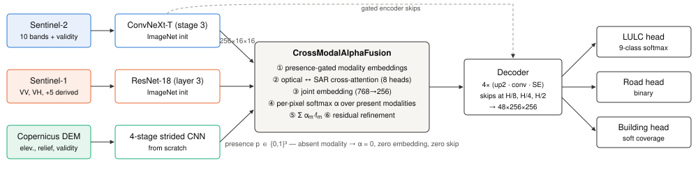
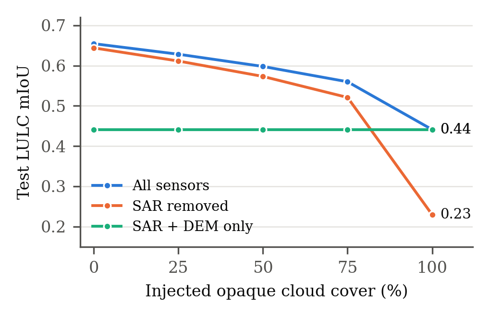
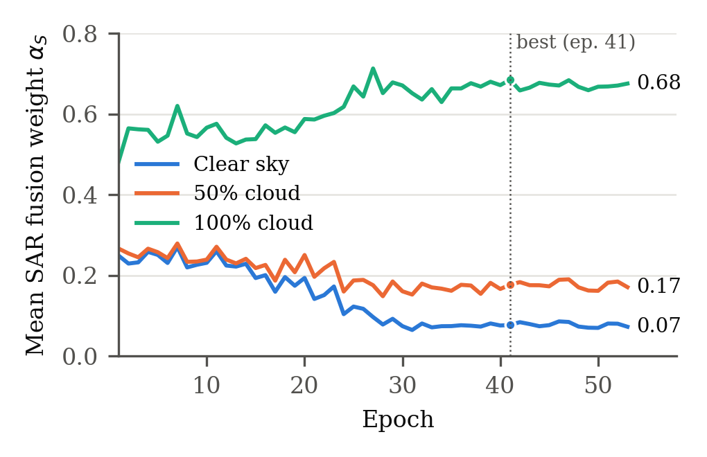
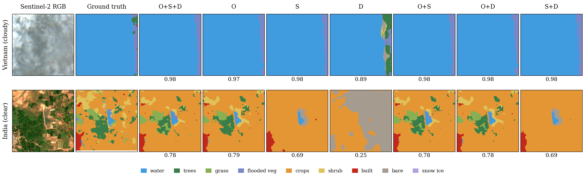

# AETHER

**Adaptive Earth observation through heterogeneous encoder representation.** AETHER maps land cover, roads and buildings from three satellite sources at once — Sentinel-2 optical, Sentinel-1 radar and a Copernicus elevation model — and decides *per pixel* how much to trust each. When cloud hides the optical image, it shifts its weight to radar and elevation instead of failing.



## What it does

| | |
|---|---|
| **Input** | A 256 × 256 tile at 10 m: 10 Sentinel-2 bands, Sentinel-1 VV/VH backscatter, Copernicus DEM, each with a validity mask |
| **Output** | A 9-class land-cover map (Dynamic World classes), a road map, a building-coverage map, and a **reliance map** — the per-pixel weight given to optical, radar and elevation |
| **Model** | 19.37 M parameters, 31.4 GFLOPs per tile |

## The key idea

A network trained on mostly clear-sky imagery learns to use optical alone. Our first model did exactly that: its radar weight stayed at about 0.19 whether or not there was cloud. AETHER fixes this in two places.

1. **Presence-aware fusion** (`models/crossmodal_fusion.py`). Each sensor is either fully present or *exactly* absent: an absent sensor gets no modality embedding, no cross-attention contribution, zero fusion weight and no skip connection. A per-pixel softmax then splits the weight among the sensors that are there.
2. **Training that makes optical fail** (`data/clouds.py`, `train.py`). Real cloud masks are injected into clear tiles — whose labels stay correct underneath — with a coverage curriculum, alongside input-level sensor dropout, per-sensor auxiliary heads, gradient modulation and model selection on a cloudy validation score.

## Results

Epoch-41 checkpoint, **held-out test set** (1,937 tiles from 137 locations never used in training). Cloud is injected over the clear image at increasing coverage:

| Cloud cover | LULC accuracy | mIoU | mIoU without radar | Weight: optical / radar / elevation |
|---|---|---|---|---|
| 0% | 0.843 | 0.654 | 0.644 | 0.866 / 0.101 / 0.032 |
| 50% | 0.801 | 0.598 | 0.573 | 0.732 / 0.204 / 0.064 |
| 75% | 0.774 | 0.560 | 0.521 | 0.594 / 0.311 / 0.095 |
| 100% | 0.664 | 0.441 | 0.230 | 0.000 / **0.733** / 0.268 |

Clear-sky test: Cohen's κ 0.806; road IoU 0.356 and building IoU 0.335 at thresholds tuned on validation (0.70 / 0.76). As cloud increases the optical weight drops to exactly zero, and radar's contribution grows from 0.01 to 0.21 mIoU.



Every sensor combination, clear-sky test set (sensors removed via presence flags):

| Sensors | LULC accuracy | mIoU | Road IoU | Building IoU |
|---|---|---|---|---|
| Optical | 0.829 | 0.635 | 0.346 | 0.322 |
| Radar | 0.601 | 0.383 | 0.215 | 0.206 |
| Elevation | 0.466 | 0.229 | 0.000 | 0.000 |
| Optical + radar | 0.840 | 0.646 | 0.354 | 0.332 |
| Optical + elevation | 0.835 | 0.644 | 0.347 | 0.326 |
| Radar + elevation | 0.646 | 0.424 | 0.217 | 0.210 |
| **All three** | **0.842** | **0.652** | **0.355** | **0.335** |

On the 1,752-tile leak-free test subset (see Limitations) every metric agrees within 0.01.

**Cost** (one Tesla T4): 19.37 M parameters, 31.4 GFLOPs per tile; fp16 batch 8 runs 172 tiles/s (1,126 km²/s) in 508 MiB of GPU memory; fp32 batch 8 runs 80 tiles/s.

Validation, epoch 41 (1,894 tiles): mIoU 0.657 clear, 0.587 at 50% cloud, 0.363 at 100% cloud.



One tile, predicted with every combination of sensors (pixel accuracy under each panel):



Full numbers: `results/paper_eval/`, produced by `scripts/run_paper_eval.sh` (see [Reproducing the evaluation](#reproducing-the-evaluation)).

## Dataset

19,149 co-registered tiles from 1,372 locations across Africa, Asia and Latin America (2017–2023), including 6,807 deliberately cloud-affected variants. Labels: Dynamic World land cover, OpenStreetMap roads, building-footprint coverage. Unlabelled pixels are masked out of every loss rather than treated as negatives. Train/validation/test are split by **location**, never by tile.

The archive is hosted on Kaggle: [`kirethikb/aether-real-cloud-multimodal-eo`](https://www.kaggle.com/datasets/kirethikb/aether-real-cloud-multimodal-eo).

## Installation

```bash
git clone https://github.com/Praneeth1-O-1/AETHER.git
cd AETHER
pip install -r requirements.txt
```

Python 3.10+ and PyTorch 2.0+. Training needs a CUDA GPU (developed on an NVIDIA T4).

## Usage

Every setting lives in `settings.py` — set `DATASET_ROOT` and `CHECKPOINT`, then:

```bash
python run_train.py      # train (writes checkpoints_skip/best.pt, history.csv)
python run_predict.py    # predict sample tiles and render PNGs
python run_evaluate.py   # full metric report across data scenarios
python run_compare.py    # ground truth vs. prediction, side by side
```

Single tile:

```bash
python inference.py --checkpoint checkpoints_skip/best.pt --tile-dir <tile_dir> --save-alpha-maps
```

### Evaluation scripts

| Script | What it measures |
|---|---|
| `scripts/tune_thresholds.py` | Road/building thresholds tuned on validation, then test metrics |
| `scripts/evaluate_full.py` | Per-class precision / recall / F1 / IoU and Cohen's κ, per data scenario |
| `scripts/ablate_modalities.py` | Every sensor combination: single, pairs, all three |
| `scripts/cloud_curve.py` | Performance and fusion weights at 0–100% cloud |
| `scripts/benchmark_gpu.py` | Parameters, FLOPs, latency, throughput, memory |
| `scripts/dataset_stats.py` | Re-derives normalization constants and loss weights |

All evaluation scripts accept `--leak-free` (see Limitations).

### Reproducing the evaluation

```bash
bash scripts/run_paper_eval.sh <checkpoint.pt> <dataset_root>
```

writes every result as JSON to `outputs/paper/`.

## Repository layout

```
models/        encoders, CrossModalAlphaFusion, decoder, task heads, losses
data/          dataset loading, location split, cloud injection
scripts/       evaluation, ablation, benchmarking, visualization
utils/         metrics and config helpers
configs/       model architecture (model.yaml)
docs/          design notes, reports, figures
settings.py    every training / evaluation setting in one place
train.py       training loop
inference.py   prediction and evaluation entry point
```

## Limitations

- **Split leak.** Location keys keep a `g_`/`c_` prefix and two spellings of some region names, so a standard tile and its cloud variant at the same coordinates can fall in different splits (185 test / 128 validation tiles in the current split). Re-keying would invalidate the trained checkpoint, so evaluation scripts report a `--leak-free` subset alongside the full split.
- **Single-date radar.** Each tile has one Sentinel-1 acquisition; many classes are better separated by radar time series.
- **Orbit channel unused.** The archive does not record orbit direction, so that SAR input channel is constant.
- Road and building IoU remain around 0.35; thin structures are hard at 10 m.

## Team

Group 108 — [names]

## License

Code: [MIT](LICENSE). Dataset labels carry their own licenses (OpenStreetMap: ODbL; Dynamic World: CC BY 4.0).
